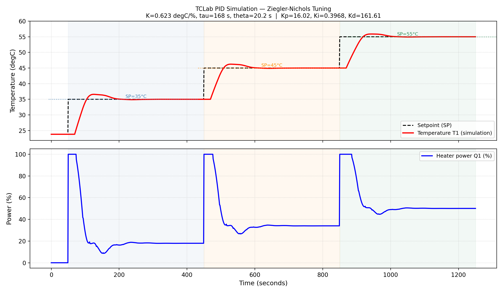
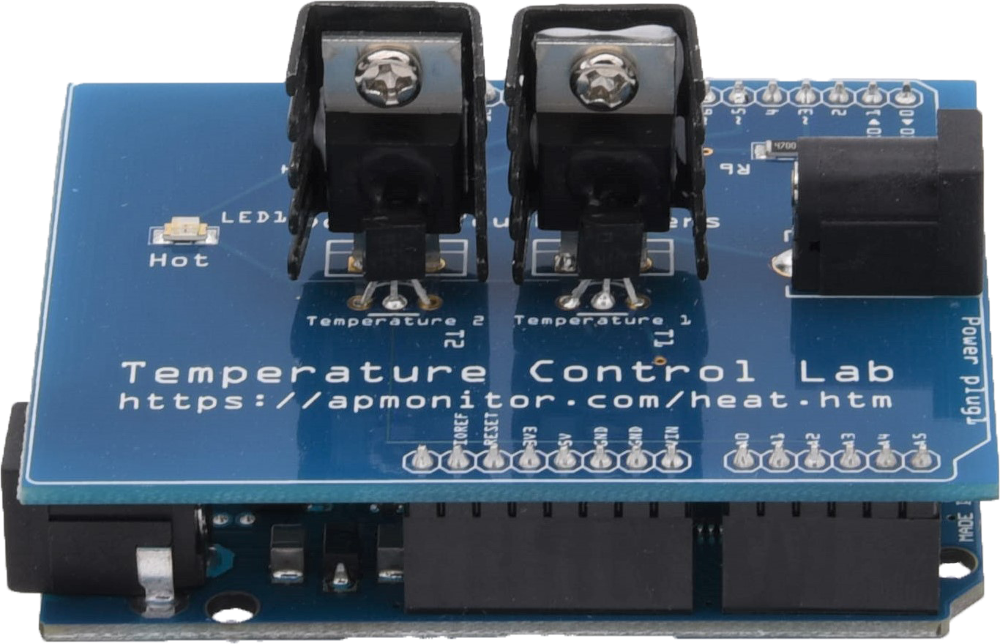

# TCLab PID Temperature Control Simulation (Ziegler-Nichols)

Proyek simulasi kendali suhu closed-loop pada modul **Temperature Control Lab (TCLab)** berbasis Arduino. 
Model matematis diidentifikasi menggunakan model orde satu dengan waktu tunda (**FOPDT: First Order Plus Dead Time**) langsung dari dataset eksperimen publik. Parameter kontroler PID dihitung secara analitik menggunakan metode **Ziegler-Nichols Open-Loop (Reaction Curve)** dilengkapi mekanisme **Anti-Windup Clamping**.


---

## Struktur Direktori

Struktur proyek dibuat minimalis, modular, dan terisolasi:

```
tclab-pid-simulation/
├── README.md               # Dokumentasi lengkap proyek
├── requirements.txt        # Dependensi Python
├── data/
│   └── raw/
│       └── tclab-data.csv  # Dataset uji step response TCLab (800 s, Q1=50%)
├── src/
│   ├── model.py            # Identifikasi parameter FOPDT (K, tau, theta, T_amb)
│   ├── tuning.py           # Perhitungan gain Ziegler-Nichols open-loop
│   └── pid.py              # Kontroler PID diskrit + anti-windup clamping
├── run_zn.py               # Script utama satu perintah untuk eksekusi pipeline
└── results/
    └── zn_result.png       # Grafik hasil simulasi suhu dan daya pemanas
```

---

## Panduan Penggunaan

Cukup jalankan dua perintah berikut:

```bash
# 1. Install dependensi
pip install -r requirements.txt

# 2. Jalankan simulasi penuh
python run_zn.py
```

Skrip `run_zn.py` secara otomatis menjalankan seluruh tahapan:
1. Membaca `data/raw/tclab-data.csv` dan fitting kurva least-squares FOPDT.
2. Menghitung gain PID $K_p, K_i, K_d$ berdasarkan aturan tuning Ziegler-Nichols.
3. Mensimulasikan sistem closed-loop dengan 3 setpoint bertahap (masing-masing 400 detik).
4. Menghitung metrik performa (*Rise Time*, *Settling Time*, *Overshoot*, *SSE*).
5. Menyimpan grafik visualisasi ke `results/zn_result.png`.

---

## 1. Identifikasi Sistem (FOPDT)

Dataset referensi diperoleh dari eksperimen nyata open-loop step response (daya pemanas $Q_1 = 50\%$ konstan selama 800 detik):
- **Sumber**: [J. C. Kantor, University of Notre Dame](https://jckantor.github.io/CBE32338/data/tclab-data.csv)

### Model Matematis
Model transfer function pendekatan FOPDT:
$$G(s) = \frac{K}{\tau s + 1} e^{-\theta s}$$

Bentuk domain waktu terhadap step input $Q$:
$$T(t) = T_{\text{amb}} + K \cdot Q \cdot \left(1 - e^{-(t - \theta)/\tau}\right) \quad \text{untuk } t \ge \theta$$

### Hasil Estimasi Parameter:
| Parameter | Nilai Hasil Fit | Satuan | Deskripsi Fisik |
|---|---|---|---|
| **K** | **0.6228** | °C/% | *Process Gain* (kenaikan suhu per 1% daya pemanas) |
| **τ** | **167.8** | detik | *Time Constant* (kecepatan respon termal mencapai 63.2%) |
| **θ** | **20.2** | detik | *Dead Time / Transport Delay* (jeda konduksi panas ke sensor) |
| **$T_{\text{amb}}$** | **23.81** | °C | Suhu lingkungan awal saat pengujian |
| **RMSE** | **0.222** | °C | Standar deviasi galat fitting terhadap data riil |

> **Catatan Analisis**: Dead time $\theta = 20.2\text{ s}$ merepresentasikan jarak fisik antara transistor pemanas (TIP31C) dan sensor suhu (TMP36). Keberadaan dead time ini menjadi faktor kritis pembatas kestabilan sistem termal.

---

## 2. Perancangan Kontroler (Ziegler-Nichols Tuning)

Metode tuning kurva reaksi terbuka (Ziegler & Nichols, 1942) untuk kontroler PID tipe ideal/paralel:

| Parameter Gain | Rumus Ziegler-Nichols | Nilai Terhitung |
|---|---|---|
| **$K_p$** | $\frac{1.2 \cdot \tau}{K \cdot \theta} = \frac{1.2 \cdot 167.8}{0.6228 \cdot 20.2}$ | **16.02** |
| **$T_i$** (Waktu Integral) | $2.0 \cdot \theta = 2.0 \cdot 20.2$ | **40.4 detik** |
| **$T_d$** (Waktu Derivatif) | $0.5 \cdot \theta = 0.5 \cdot 20.2$ | **10.1 detik** |
| **$K_i$** | $\frac{K_p}{T_i} = \frac{16.02}{40.4}$ | **0.397** |
| **$K_d$** | $K_p \cdot T_d = 16.02 \cdot 10.1$ | **161.61** |

### Algoritma PID & Anti-Windup Clamping
Persamaan beda diskrit pada modul `src/pid.py`:
$$u[k] = K_p \cdot e[k] + K_i \sum e[j] \Delta t + K_d \frac{e[k] - e[k-1]}{\Delta t}$$
- **Saturasi Aktuator**: Daya pemanas dibatasi pada rentang fisik $0 \le u \le 100\%$.
- **Anti-Windup Clamping**: Akumulasi suku integral dibekukan (*freezed*) apabila sinyal kontrol mencapai batas saturasi dan arah error memperparah kondisi jenuh, mencegah lonjakan *recovery time* saat pergantian setpoint.

---

## 3. Hasil Simulasi & Evaluasi Kinerja

Skenario pengujian mengevaluasi respon pelacakan suhu pada **tiga setpoint** berurutan: **35°C**, **45°C**, dan **55°C** (masing-masing ditahan selama **400 detik**). Rentang ini dipilih karena berada dalam kapasitas fisik pemanas tanpa ekstrapolasi berlebih (pada daya 50%, suhu jenuh modul adalah ~55°C).

### Tabel Metrik Kinerja:
| Setpoint | Rentang Waktu | Rise Time (10%–90%) | Settling Time (kriteria 2%) | Overshoot | Steady-State Error ($e_{ss}$) |
|---|---|---|---|---|---|
| **35 °C** | $t = 50 - 450\text{ s}$ | **27 detik** | **138 detik** | **14.18%** | $+0.001\text{ °C}$ |
| **45 °C** | $t = 450 - 850\text{ s}$ | **30 detik** | **140 detik** | **12.35%** | $+0.000\text{ °C}$ |
| **55 °C** | $t = 850 - 1250\text{ s}$ | **38 detik** | **147 detik** | **8.86%** | $+0.000\text{ °C}$ |

### Analisis Respon:
1. **Karakteristik Ziegler-Nichols**: Metode ZN dikenal menghasilkan respons yang agresif. Overshoot sebesar ~8%–14% masih berada di bawah target desain teoritis ZN (~25%), menunjukkan redaman sistem termal yang baik.
2. **Eliminasi Error Steady-State**: Aksi integral ($K_i$) berhasil meniadakan error tunak di seluruh rentang setpoint ($e_{ss} \approx 0.00\text{ °C}$).
3. **Efisiensi Transisi**: Penerapan *anti-windup clamping* membuat waktu settling stabil di kisaran ~140 detik pada tiap kenaikan suhu 10°C tanpa terjadi fenomena *sluggish windup recovery*.

---

## 4. Visualisasi Grafik & Perangkat Keras

### Hasil Simulasi Pelacakan Suhu (PID Ziegler-Nichols)


### Modul Fisik dan Rangkaian Alat
| Skema Wiring & Rangkaian | Foto Modul TCLab |
|---|---|
|  |  |
