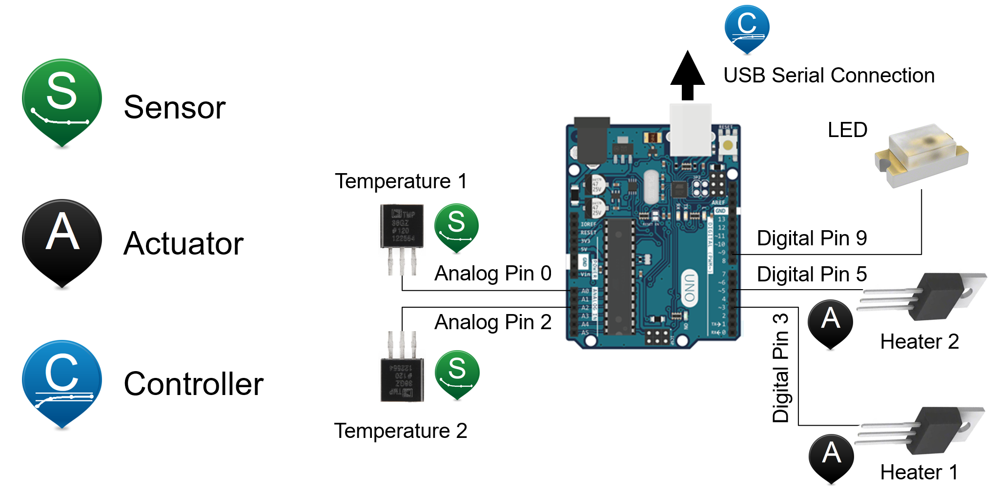

# TCLab PID Simulation

PID temperature control simulation on a Temperature Control Lab (TCLab) model.
Plant parameters (K, τ, θ) are identified from a public step-response dataset.

> For the full analysis report (in Indonesian), see [laporanawal.md](laporanawal.md).

---

## System Overview



---

## Project Structure

```
tclab-pid-simulation/
├── data/
│   └── raw/tclab-data.csv      # downloaded by download_data.py
├── src/tclab_pid/
│   ├── model.py                # FOPDT thermal plant model
│   ├── pid.py                  # discrete PID with anti-windup
│   ├── identification.py       # curve-fit K, tau, theta from CSV
│   ├── metrics.py              # overshoot, rise/settling time, IAE
│   └── plotting.py
├── scripts/
│   ├── download_data.py        # 1. download dataset
│   ├── run_identification.py   # 2. identify plant parameters
│   ├── run_simulation.py       # 3. run PID simulation
│   └── run_antiwindup_comparison.py  # 4. compare with/without anti-windup
└── results/                    # auto-generated
    ├── params.json
    ├── metrics.json
    └── figures/
```

---

## Usage

```bash
pip install -r requirements.txt
python scripts/download_data.py
python scripts/run_identification.py
python scripts/run_simulation.py
```

---

## Parameter Identification

Dataset: [tclab-data.csv](https://jckantor.github.io/CBE32338/data/tclab-data.csv)  
Source: J. C. Kantor, University of Notre Dame

| Parameter | Fitted Value | Report Value | Difference |
|-----------|-------------|--------------|------------|
| **K** (°C/%) | **0.6228** | 0.65 | −4.2% |
| **τ** (s) | **167.8** | 180 | −6.8% |
| **θ** (s) | **20.2** | 0.0 | +20.2 s |
| **T_amb** (°C) | **23.81** | 23.0 | +0.81 |
| **RMSE** (°C) | **0.222** | — | — |

> **Note**: Differences between fitted and nominal values are expected — the report uses rounded/nominal values while the fit uses least-squares from real data.  
> Time delay θ = 20.2 s is significant and contributes to settling time differences.

---

## Simulation Results

**PID Gains**: Kp = 8.0, Ki = 0.08, Kd = 12.0  
**Model**: FOPDT from data identification

### Step 23 → 50 °C  [Window: 50 – 600 s]

| Metric | Simulation | Report | Note |
|--------|-----------|--------|------|
| Peak temperature | 49.99 °C | 50.06 °C | ≈ same |
| Overshoot | **0.00%** | 0.23% | No overshoot (θ responds differently) |
| Rise time (10–90%) | **81 s** | 104 s | Faster (τ smaller from fit) |
| Settling time (2%) | **240 s** | 168 s | Longer (due to θ = 20 s) |
| Steady-state error | **0.012 °C** | −0.005 °C | Nearly zero ✅ |
| **IAE** [50–600 s] | **1813.9** | 2176.72 | ⚠️ Different window/parameters |

### Step 50 → 65 °C  [Window: 600 – 1200 s]

| Metric | Simulation |
|--------|-----------|
| Peak temperature | 65.00 °C |
| Overshoot | 0.00% |
| Rise time (10–90%) | 80 s |
| Settling time (2%) | 238 s |
| Steady-state error | 0.004 °C |
| IAE [600–1200 s] | 1031.5 |

---

## Key Findings

### 1. PI vs PID Controller (Negligible Derivative Effect)
The derivative action has almost no significant impact on system performance. PI and PID controllers yield nearly identical results (IAE for PI = **1827.1** vs PID = **1814.6**). The dominant role in eliminating steady-state error lies entirely within the **integral action**.

### 2. Sensitivity: Time Delay (θ) vs. Gain (K)
The thermal system is far more sensitive to changes in time delay than gain. When time delay is increased to θ = 40 s, the system begins to oscillate — resulting in an **overshoot of 6.65%** and settling time worsening to **618 s**. Transport delay is the main stability limit for this thermal plant.

### 3. Extrapolation Warning on High Setpoints
Testing at setpoints of **65 °C** and **80 °C** is far outside the identification dataset range. The actual maximum temperature in `tclab-data.csv` is only ~**54.75 °C**. Performance simulations at these setpoints are pure **extrapolations** of the linear FOPDT model.

---

## Generated Files

| File | Description |
|------|-------------|
| `data/raw/tclab-data.csv` | Public TCLab dataset (21508 bytes) |
| `results/params.json` | Fitted parameters: K, τ, θ, RMSE |
| `results/metrics.json` | Full metrics for both steps with window info |
| `results/figures/identification_fit.png` | FOPDT curve fit vs real data |
| `results/figures/tclab_pid_performance.png` | PID response plot (temperature + power) |

---

## Simulation Figures

### Parameter Identification


### PID Performance & Anti-Windup


### Robustness & Extrapolation

